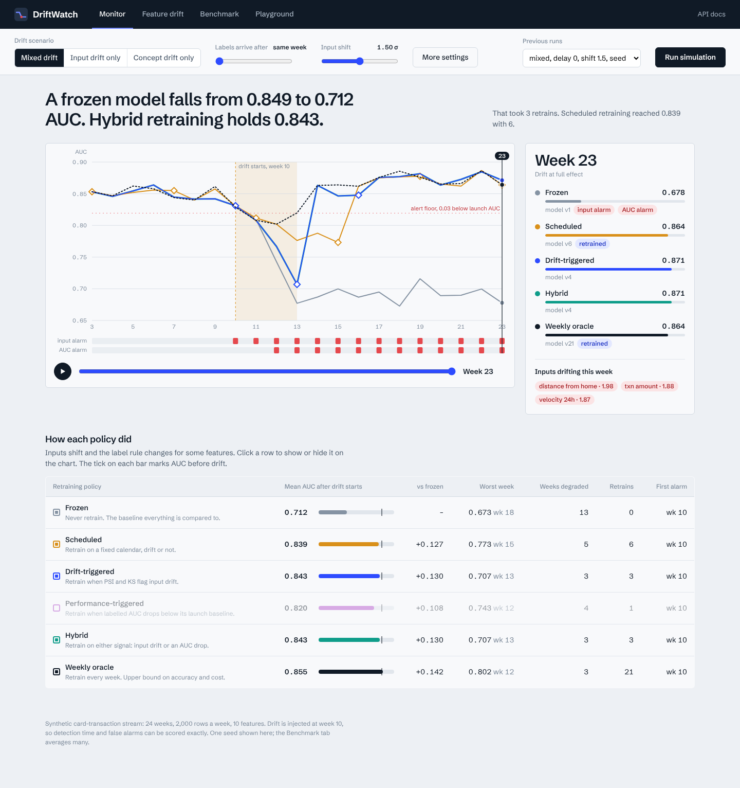
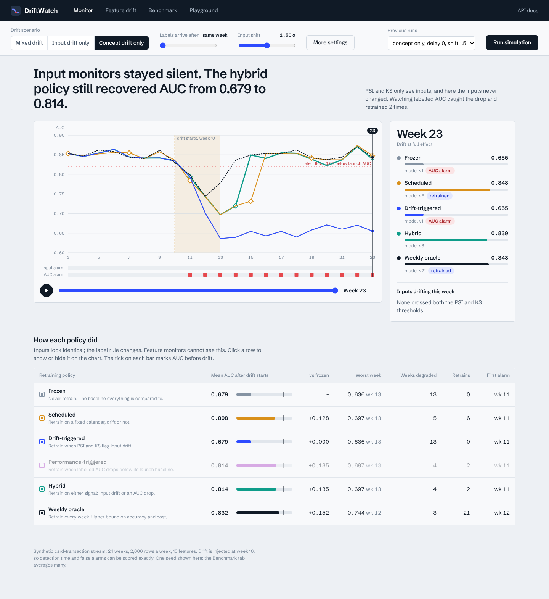
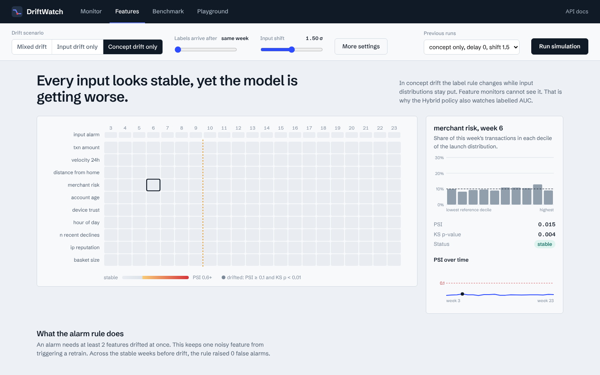
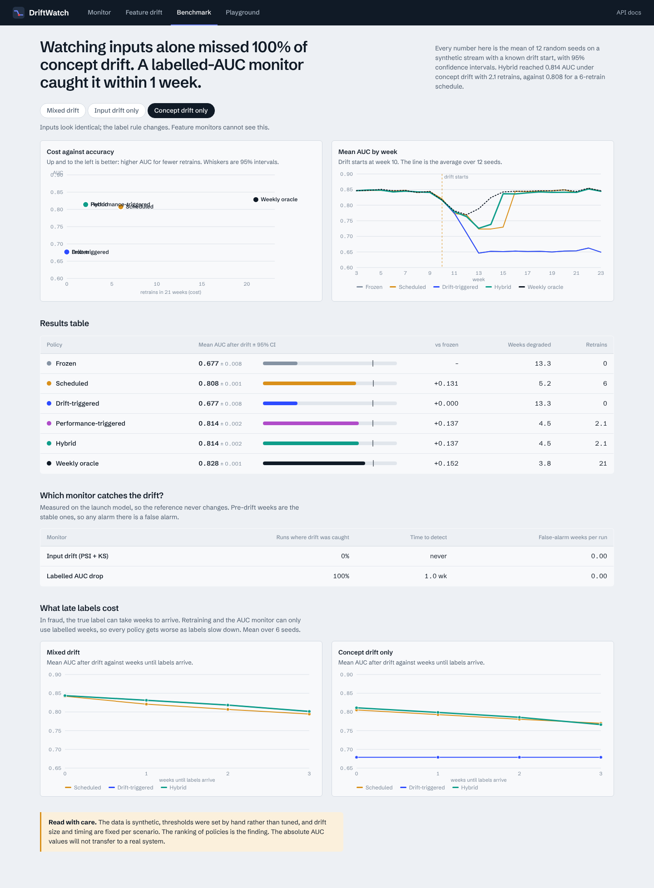
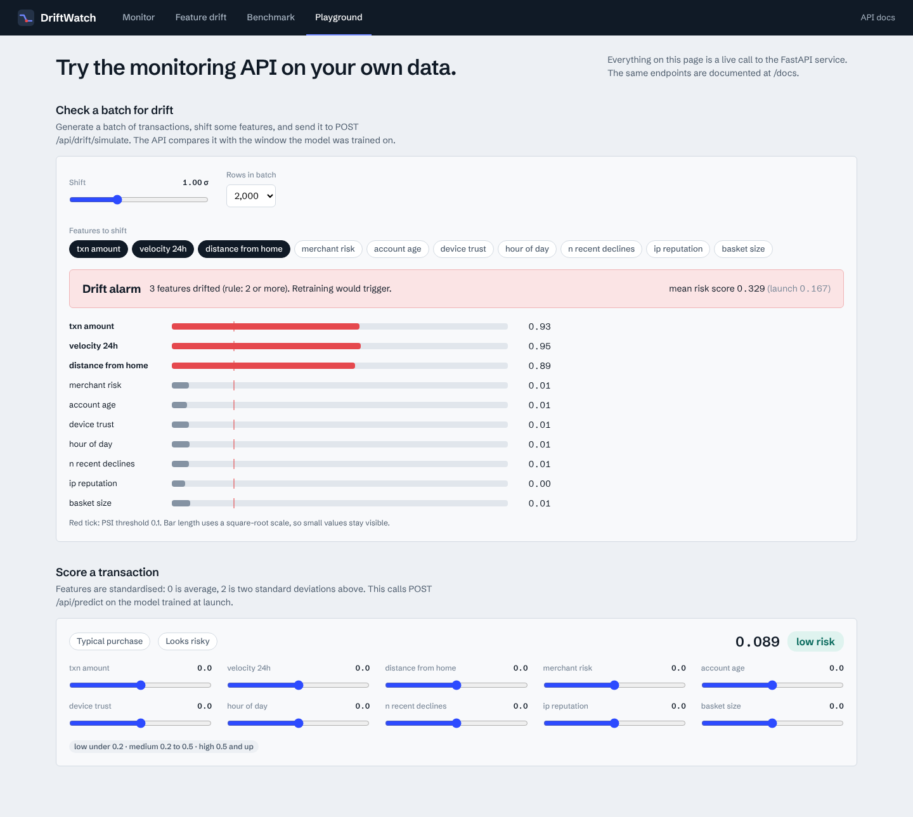
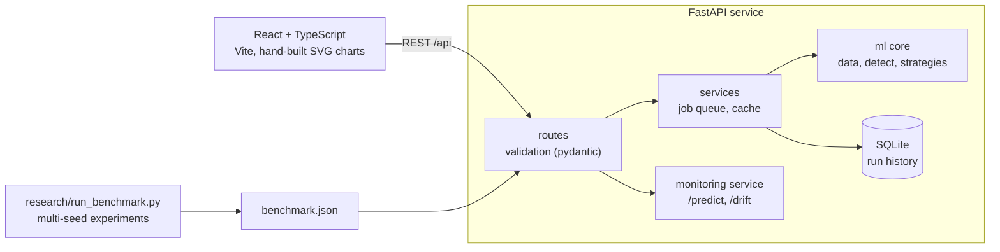

# DriftWatch

**Monitor a deployed fraud classifier for drift, and find out when retraining is actually worth it.**

DriftWatch simulates a card-transaction model going stale, watches it with two kinds of monitors, and compares six retraining policies on accuracy and cost. A FastAPI service runs the experiments and exposes the monitors; a React dashboard lets you replay the drift week by week.



## What it found

12 random seeds per scenario, 95% confidence intervals in the app. Full tables on the Benchmark tab.

| | Frozen | Scheduled (every 4 wk) | Drift-triggered | **Hybrid** |
|---|---|---|---|---|
| Mixed drift, AUC after drift (retrains) | 0.690 (0) | 0.841 (6) | 0.842 (3) | 0.842 (3) |
| Concept drift only (retrains) | 0.677 (0) | 0.808 (6) | 0.677 (0) | **0.814 (2.1)** |

- **Feature monitors are blind to concept drift.** PSI and KS caught drift in 12 of 12 mixed runs, immediately and with zero false alarms, and in 0 of 12 concept-drift runs. A drift-triggered policy then never retrains and behaves like a frozen model.
- **A labelled-AUC monitor closes that gap.** It caught concept drift in 12 of 12 runs, about one week after onset, with no false alarms on stable weeks. The Hybrid policy (retrain on either signal) matched scheduled retraining on accuracy with about a third of the retrains.
- **It is not a free win.** On mixed drift the AUC monitor adds nothing, because the input monitor already fires. And labels arrive late in fraud: as delay grows from 0 to 3 weeks, every policy loses accuracy, and Hybrid's edge over a schedule disappears (0.766 against 0.770 at 3 weeks).
- **Drift is not always harmful.** With input drift only, a frozen model lost about 0.6 AUC points.



## The app

| Monitor | Features |
|---|---|
| Replayable AUC timeline for every policy, with retrain markers, alarm lanes and a week inspector | PSI heatmap by feature and week, with per-feature distribution and trend |
|  |  |

| Benchmark | Playground |
|---|---|
| Cost against accuracy, detector quality, effect of label delay | Live calls to `/api/drift/simulate` and `/api/predict` |
|  |  |

## Architecture



- Simulations take several seconds, so `POST /api/simulations` queues a background job and returns `202`; the UI polls for progress. Identical configurations are hashed and served from the database instead of recomputed.
- The built frontend is served by the same FastAPI process, so one container runs everything.

```
backend/app/
  ml/          data.py  detect.py  strategies.py      # the science, no web code
  services/    simulations.py  monitoring.py          # job queue, caching, live scoring
  api/         routes.py                              # HTTP layer
  schemas.py   db.py   config.py   main.py
backend/tests/ # 27 tests: detectors, data, policies, API lifecycle
frontend/src/  # pages/, components/, lib/
research/      # run_benchmark.py and results/benchmark.json
```

## Run it

```bash
make install          # backend and frontend dependencies
make dev              # API on :8000, UI on :5173
# or one container:
docker compose up --build        # http://localhost:8000
make test             # 27 backend tests and the frontend type check
make benchmark        # regenerate research/results/benchmark.json (about 10 minutes)
```

Interactive API docs are at `/docs`.

### Deploy on Render

1. Push this folder to a GitHub repo (the `Dockerfile` must be at the repo root).
2. On render.com choose **New + > Web Service**, connect the repo, set **Runtime** to **Docker** and the instance type to **Free**.
   Set **Health Check Path** to `/api/health`. No environment variables are needed. (Or use **New + > Blueprint**, which reads `render.yaml`.)
3. Deploy. The first build takes a few minutes (it builds the React app and installs the Python packages).

Notes for the free plan: the service sleeps after about 15 minutes without traffic and takes roughly 30 to 60 seconds to wake;
the run history lives in a SQLite file that is wiped on each restart or deploy (the three headline scenarios are recomputed at
startup, so the dashboard is never empty); and the shared CPU makes a new simulation slower than on a laptop.

| Endpoint | Purpose |
|---|---|
| `POST /api/simulations` | Queue a simulation (scenario, label delay, thresholds, policies). Returns `202`. |
| `GET /api/simulations/{id}` | Status, progress and the full week-by-week result |
| `GET /api/simulations` | Run history |
| `GET /api/benchmark` | Multi-seed results with confidence intervals |
| `POST /api/drift/check` | PSI and KS report for a batch you send (200 rows or more) |
| `POST /api/drift/simulate` | Same, on a generated batch with chosen features shifted |
| `POST /api/predict` | Risk scores from the launch model |

## Method

- **Data.** A synthetic weekly stream: 24 weeks, 2,000 transactions a week, 10 standardised features, about 17% positive rate before drift. Synthetic on purpose, so the drift start and size are known and detection can be scored exactly. Drift ramps in over 4 weeks from week 10.
- **Scenarios.** Mixed (three features shift by up to 1.5 σ and the label rule flips for three others), input drift only, concept drift only.
- **Model.** scikit-learn `HistGradientBoostingClassifier`, trained on the first three weeks and retrained on a three-week window.
- **Monitors.** Input: a feature is drifted when PSI ≥ 0.1 and a KS test gives p < 0.01; an alarm needs two features. Performance: labelled AUC of the deployed model falls 0.04 below a launch baseline measured on a true hold-out week. The baseline stays fixed after retraining, because re-deriving it from a window that is mid-drift would lower the bar and silence the monitor.
- **Label delay.** Labels for week *t* arrive at the end of week *t* + delay. Retraining and the performance monitor use only labelled weeks.
- **Metric.** AUC on each week, scored before any retraining that week.

## Limitations

- The data is synthetic, so absolute numbers will not transfer. The ranking of policies is the finding.
- Thresholds, drift size and window length were chosen by hand and not swept.
- The first alarm fires in the first week of drift, so the first retrain uses a window that is mostly pre-drift and accuracy dips before a later retrain fixes it. A drift-aware window would help and is not implemented.
- Policies are compared on one drift event per run, with a single model family.
- The pre-drift positive rate is about 17%. An earlier version of this project said 11%; that figure was wrong.
